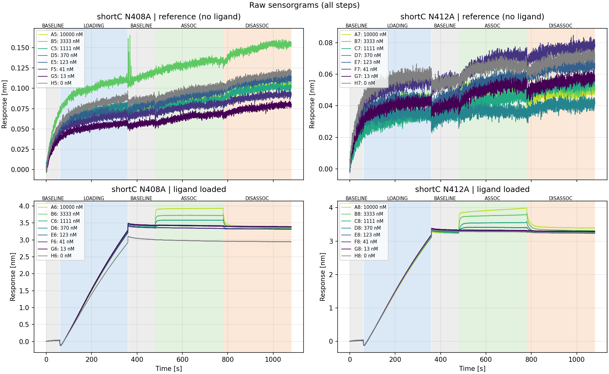
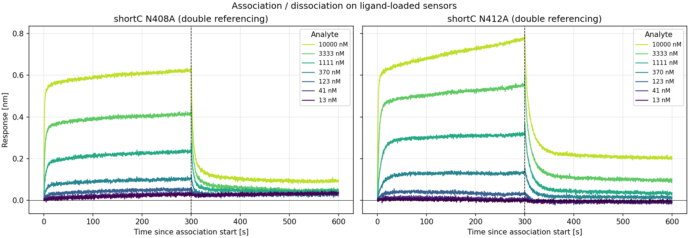
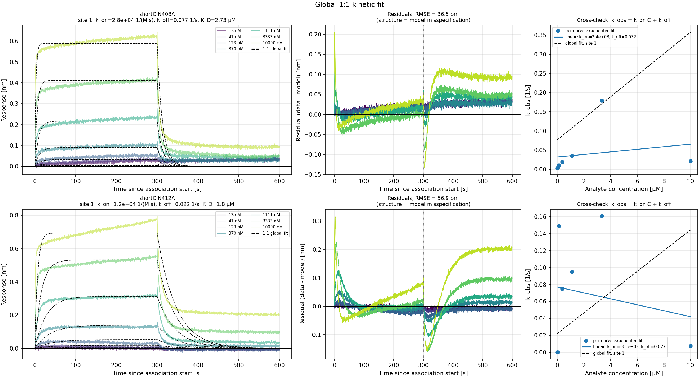
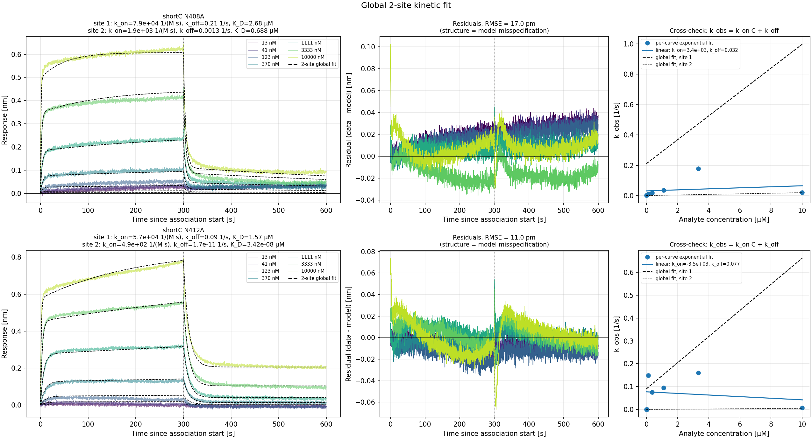
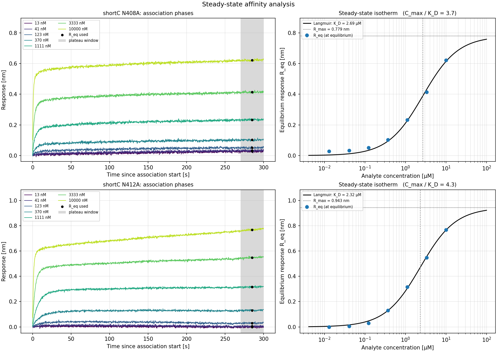

# BLI sensorgram analysis: a practice project

A small, self-contained Python project for **practising the analysis of binding-kinetics
sensorgrams**: reading raw instrument files, referencing, fitting kinetic and steady-state
models, and judging critically whether a model actually describes the data.

The example data come from a **bio-layer interferometry (BLI)** experiment on a Sartorius
OctetRED96e, not SPR. The analysis concepts (association/dissociation, k_on, k_off,
K_D) are the same; the main practical difference is that the signal is a wavelength shift
in **nm** rather than resonance units (RU).

## Example dataset

`biotin CK1 short C NtoA muts/`: one run, 32 sensors (one `.frd` file per sensor).

| | |
|---|---|
| Sensor | Streptavidin (SA) |
| Ligand | biotinylated CK1 (`75 nM biotin CK1dC`), loaded on half of the sensors |
| Analytes | two point mutants, `shortC N408A` and `shortC N412A` |
| Concentrations | 0, 13, 41, 123, 370, 1111, 3333, 10000 nM (3-fold series) |
| Steps | baseline 60 s, loading 300 s, baseline 120 s, **association 300 s**, **dissociation 300 s** |

Each analyte/concentration was measured on a ligand-loaded sensor **and** on a bare SA
reference sensor, which allows full double referencing.

## Scripts

| Script | What it does | Output (in `results/`) |
|---|---|---|
| `plot_sensorgrams.py` | Raw traces of all sensors with assay steps shaded, plus the aligned and referenced association/dissociation curves | `raw_overview.png`, `referenced_traces.png`, optional `sensorgrams_long.csv` |
| `fit_kinetics.py` | **Global kinetic fit** (shared k_on, k_off across concentrations) with a 1:1 Langmuir or a two-site heterogeneous-ligand model; gives k_on, k_off, K_D, residuals and a k_obs-vs-C cross-check | `kinetic_fit_<model>_<rmax>.png/.csv` |
| `fit_steady_state.py` | **Steady-state affinity**: plateau response vs concentration, fitted with the Langmuir isotherm; checks whether equilibrium was reached and whether R_max is constrained | `steady_state_fit.png`, `steady_state_fit.csv`, `steady_state_plateaus.csv` |
| `sensorgram_tools.py` | Shared module: `.frd` parser, alignment, referencing, per-curve exponential fit | n/a |

The figures in `results/` are committed so this README can display them. The CSV tables are
not committed; running the scripts regenerates both.

```bash
pip install -r requirements.txt

python plot_sensorgrams.py
python fit_kinetics.py                    # 1:1 model
python fit_kinetics.py --model 2site      # heterogeneous-ligand model
python fit_steady_state.py
```

Every script takes an optional data folder as its first argument and `--help` lists the
options. Common ones:

* `--reference {none,reference,zero,double}`: referencing mode (default `double`)
* `--exclude-conc 10000`: leave concentrations [nM] out of a fit
* `--rmax {global,local}`: one R_max for all sensors, or one per sensor (kinetics)
* `--plateau {mean,fit}`, `--window-s 30`: how the plateau is taken (steady state)
* `--no-show`: only save the figures (e.g. for batch runs)

## Method in brief

**Parsing.** `.frd` files are XML. Every assay step stores time [s] and response [nm] as
base64-encoded little-endian float32 arrays (`<AssayXData>`, `<AssayYData>`).

**Alignment and referencing.** Time is set to 0 at the start of association and the
response to 0 at the mean of the last 5 s of the preceding baseline. Double referencing then
subtracts (i) the bare-SA reference sensor at the same analyte concentration, which removes
non-specific binding and the bulk refractive-index shift, and (ii) the 0 nM trace on a loaded
sensor, which removes drift of the loaded tip:

    R = (loaded − reference)_C − (loaded − reference)_0 nM

**1:1 kinetics.** For `A + L ⇌ AL` at constant analyte concentration C:

    association:   R(t) = R_eq · (1 − exp(−k_obs·t)),   k_obs = k_on·C + k_off,   R_eq = R_max·C / (C + K_D)
    dissociation:  R(t) = R(t_d) · exp(−k_off·(t − t_d))

All concentrations are fitted together (global fit). Rate constants are fitted as log10
values, so they stay positive and well conditioned across many decades.

**Steady state.** `R_eq(C) = R_max·C / (K_D + C)` fitted to the plateau of each association
phase. This is independent of the rate constants, so it cross-checks the kinetic K_D.

Units: t [s], R [nm], C [M], k_on [1/(M·s)], k_off [1/s], K_D [M].

## What the example data show (and why that is instructive)

**Raw sensorgrams.** Top row: bare-SA reference sensors (no ligand). Bottom row:
CK1-loaded sensors. The references show only slow drift (< 0.15 nm over the whole run) and no
concentration-dependent association, so non-specific binding to streptavidin is small.
Check the loading step: ligand loading is very uniform, **except sensor H6** (N408A, 0 nM),
which loaded ~13 % less (~2.95 vs ~3.4 nm). H6 is the 0 nM trace used in double referencing
for N408A, so its drift may not exactly match the other loaded tips. `--reference reference`
(no 0 nM subtraction) or `--rmax local` are ways to test how much this matters.



**Double-referenced association and dissociation**



**Global 1:1 fit.** The residuals (middle) are systematic, with a fast and a slow phase that
one exponential cannot capture. The k_obs-vs-C cross-check (right) is not a rising straight line.



**Global two-site (heterogeneous ligand) fit.** Most of the residual structure is gone,
but see the caveats below.



**Steady-state isotherm.** Plateau (grey window) vs concentration on a log axis.



| | N408A | N412A |
|---|---|---|
| 1:1 global fit, K_D | 2.7 µM | 1.8 µM |
| 2-site fit, fast site K_D | 2.7 µM | 1.6 µM |
| Steady state, K_D (plateau mean) | 2.7 µM | 2.3 µM |
| C_max / K_D | 3.7 | 4.3 |

*(defaults: double referencing, global R_max)*

* **The data are not 1:1.** Both analytes show a fast phase (seconds) and a slow phase in
  association and dissociation. The 1:1 residuals are systematic, and k_obs vs C is not a
  rising straight line. The two-site model removes most of the structure, but the slow
  component should not be read as a second binding site without further evidence: it can just
  as well be ligand heterogeneity, avidity, or non-specific binding. For N412A its k_off goes to
  ~0 and is flagged as **not identifiable** within a 300 s dissociation.
* **The fast/dominant interaction is consistent across methods:** K_D ≈ 2–3 µM for both
  mutants, i.e. weak, fast-on/fast-off binding. For such binders the steady-state analysis is
  usually the more robust number.
* **R_max is only moderately constrained:** the highest concentration is only ~4 × K_D, so the
  isotherm does not fully saturate. Plateau and K_D are strongly correlated (r ≈ 0.9).
* **Confidence intervals are optimistic.** They come from the Jacobian, which assumes
  independent residuals. With 5 Hz sampling and systematic misfit the residuals are strongly
  autocorrelated, so the real uncertainty is larger. Replicate sensors would be needed for an
  honest error estimate.

## Possible extensions (exercises)

* Mass-transport-limited or bivalent-analyte models; linear-drift term in the model
* Residual bootstrap (block bootstrap for autocorrelated residuals) for realistic CIs
* Local vs global R_max comparison, information criteria (AIC/BIC) for model selection
* Batch processing of several runs / mutants into one summary table

## Data note

The `.frd` files are raw instrument output and are treated as read-only. The `.zip` in the
data folder is a redundant archive of the same files and is excluded by `.gitignore`.
